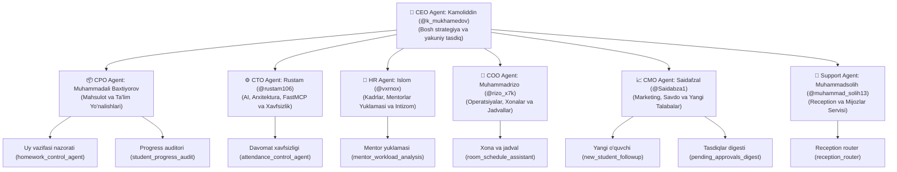

# AGENTS.md — KFC Jamoasi: MARS LMS Ko‘p Agentli Tizim Arxitekturasi

Ushbu hujjat **KFC Jamoasi** tomonidan **MARS IT School LMS** boshqaruv tizimi uchun yaratilgan 7 nafar C-Level va 10 ta ixtisoslashgan Hermes AI Agentlari, ularning vazifalari, bo‘ysunuv ierarxiyasi, ishlatadigan API va MCP toollari, ish zanjirlari, qat’iy taqiqlari hamda **Inson Tasdig‘i (Human-in-the-Loop — HITL)** standartlarini belgilaydi.

---

## 1. Vazifalari (Asosiy Maqsadlar)
- Filiallararo dars jarayonlari, davomat va kadrlar intizomini to‘liq avtomatlashtirilgan monitoring qilish.
- Qarzdorlik, to‘lovlar, kassa qoldiqlari va moliyaviy hisobotlarni real vaqtda yuritish.
- Xonalar bandligi, vaqt slotlari va mentorlar haftalik ish yuklamasini muvozanatlash.
- Reception kiruvchi murojaatlarini toifalab, mas’ullarga yo‘naltirish va javob loyihalarini tayyorlash.
- Barcha amallarni faqat KFC jamoasining mustaqil backend serveri (`https://mars-backend-six.vercel.app`) orqali xavfsiz boshqarish.

---

## 2. Kimga Hisobot Beradi?
- **Hermes Mars Master Orchestrator:** Bevosita **CEO (Kamoliddin @k_mukhamedov)** va **CTO (Rustam @rustam106)** ga hisobot beradi.
- **C-Level Agentlar:** Bevosita **CEO Agent (Kamoliddin)** ga hisobot topshiradi (Mahsulot va o‘quv dasturlari bo‘yicha **CPO Muhammadali** bilan hamkorlikda).
- **Sub-Agentlar (10 ta amaliy agent):** O‘z departamentining tegishli C-Level rahbar agentiga hisobot beradi.
- **Yakuniy instansiya:** Strategik va moliyaviy qarorlar bo‘yicha hisobot faqat inson rahbarlariga (Ta’sischilar va CEO) taqdim etiladi.

---

## 3. Kimni Boshqaradi (7 Nafarlik KFC Jamoasi Tuzilmasi)
Agentlar tizimi qat’iy ierarxiya asosida quyidagi 7 nafar rahbar agenti tuzilmasini boshqaradi:

---

## 4. Qaysi API va FastMCP Toollarni Ishlatadi?
Tizim FastMCP (Python 3.14 + stdio) orqali `https://mars-backend-six.vercel.app` API ga bog‘langan 22 ta tooldan foydalanadi:

| № | FastMCP Tool Nomi | Bog‘langan Endpoint | Mas’ul Agent | Vazifasi |
|---|-------------------|---------------------|--------------|----------|
| 1 | `lms_login` | `POST /api/auth/login` | Barcha agentlar | JWT tokenni olish va sessiyani faollashtirish |
| 2 | `lms_context` | `GET /api/branch/overview` | CEO, CTO | Filial umumiy ko‘rsatkichlari |
| 3 | `list_groups` | `GET /api/branch/groups` | COO, HR | Guruhlar, dars vaqti, xonalar va mentorlar |
| 4 | `list_students` | `GET /api/branch/students` | CMO, CPO | O‘quvchilar ro‘yxati va holati |
| 5 | `get_debts` | `GET /finance/debts` | CEO, Sub-Agent 1 | Qarzdorlar ro‘yxati, summa va kechikish kunlari |
| 6 | `get_attendance` | `GET /attendance` | CTO, Sub-Agent 2 | Davomat tarixi va dars qoldirishlar |
| 7 | `get_homework` | `GET /homework` | CPO, Sub-Agent 3 | Topshirilmagan va tekshirilmagan vazifalar |
| 8 | `get_finance_report` | `GET /api/finance/overview` | CEO, Sub-Agent 4 | Tushum, xarajat, kassa balansi va sof foyda |
| 9 | `get_payments` | `GET /api/branch/payments` | CEO | To‘lovlar jurnali (uzcard, humo, naqd) |
| 10 | `get_pending_approvals`| `GET /api/branch/waitlist` | CMO, Sub-Agent 5 | Kutish ro‘yxati va tasdiq arizalari |
| 11 | `get_room_plan` | `GET /api/branch/capacity` | COO, Sub-Agent 7 | Xonalar bandligi va optimal slotlar |
| 12 | `get_student_progress` | `GET /student-progress` | CPO, Sub-Agent 9 | Talabaning akademik ko‘rsatkichlari |
| 13 | `debt_control_agent` | Kompozit FastMCP tool | Sub-Agent 1 | Qarzdorlik tahlili va eslatma loyihasi |
| 14 | `attendance_control_agent`| Kompozit FastMCP tool | Sub-Agent 2 | 2+ dars qoldirganlarni aniqlash |
| 15 | `homework_control_agent` | Kompozit FastMCP tool | Sub-Agent 3 | Topshirilmagan vazifalar bildirishnomasi |
| 16 | `daily_finance_report` | Kompozit FastMCP tool | Sub-Agent 4 | Kunlik moliyaviy svodka |
| 17 | `new_student_followup` | Kompozit FastMCP tool | Sub-Agent 5 | Yangi o‘quvchilar konversiyasi |
| 18 | `pending_approvals_digest`| Kompozit FastMCP tool | Sub-Agent 6 | Chegirma va muzlatishlarni guruhlash |
| 19 | `room_schedule_assistant`| Kompozit FastMCP tool | Sub-Agent 7 | Xona to‘qnashuvlarini yechish |
| 20 | `mentor_workload_analysis`| Kompozit FastMCP tool | HR (Islom), Sub-Agent 8 | Mentorlar yuklamasini muvozanatlash |
| 21 | `student_progress_audit` | Kompozit FastMCP tool | Sub-Agent 9 | O‘zlashtirish diagnostikasi |
| 22 | `reception_router` | Kompozit FastMCP tool | Support, Sub-Agent 10 | Kiruvchi murojaatlarni 5 toifaga ajratish |

---

## 5. Ish Zanjiri (Chains of Action)
Har bir agent o‘z vazifasini qat’iy 6 bosqichli zanjir asosida bajaradi:
1. **Trigger (Hodisa / Vaqt):** Rejalashtirilgan vaqtda (masalan, har kuni 08:30) yoki kiruvchi so‘rov orqali zanjir boshlanadi.
2. **Autentifikatsiya (`lms_login`):** Agent KFC backendiga tegishli RBAC roli bilan kirib, sessiyani tekshiradi.
3. **Ma’lumot yig‘ish (`Fetch`):** Tegishli FastMCP tool chaqirilib, so‘nggi holat olinadi.
4. **Filtrlash va Tahlil (`Analyze & Segment`):** Anomaliyalar, dars qoldirishlar yoki mentorlar yuklamasi tahlil qilinadi.
5. **Loyihalash (`Drafting`):** Xulosa, tavsiya yoki bildirishnoma loyihasi tayyorlanadi.
6. **Inson Tasdig‘i va Jo‘natish (`HITL & Dispatch`):** Mas’ul rahbar tasdiqlagach, harakat amalga oshiriladi.

---

## 6. Nima Qilmaydi? (Taqiqlar va Inson Tasdig‘i — HITL)

### 🛡 A. Qat’iy Inson Tasdig‘i (Human-in-the-Loop — HITL):
1. **Pul va Moliyaviy Operatsiyalar:**
   - **Qat’iy taqiq:** Agent tomonidan pul yechish, to‘lovni bekor qilish (refund), qarzni o‘chirish, oylik maosh to‘lash, o‘zboshimchalik bilan chegirma yoki bonus berish.
   - **Ruxsat etilgan jarayon:** Agent faqat hisob-kitob qiladi, tahlil qiladi, tavsiya va hisobot loyihasini tayyorlaydi.
   - **Tasdiqlovchi mas’ul:** **CEO (Kamoliddin @k_mukhamedov)**. Har qanday moliyaviy o‘zgarish faqat inson rahbarining tizimdagi elektron tasdig‘i orqali amalga oshadi.

2. **Shaxsiy Ma’lumotlar (PII):**
   - **Qat’iy taqiq:** O‘quvchilar, xodimlar va ota-onalarning telefon raqamlari, pasport ma’lumotlari, yashash manzillarini to‘liq ochiq holda tashqi kanallarga chiqarish yoki hisobotlarda ochiq qoldirish.
   - **Xavfsizlik standarti:** Barcha telefon raqamlar `+998 90 *** ** 45` shaklida maskalanadi.
   - **Xabar yuborish tasdig‘i:** Tashqi ogohlantirish xabarlari faqat mas’ul xodim ko‘rib chiqib tasdiqlaganidan keyin jo‘natiladi.

### 🚫 B. Boshqa Xavfsizlik Taqiqlar:
- **Xavfsizlik buzilishida rolni o‘zgartirish man etiladi:** 403 Forbidden javobi olinganda rolni `admin`ga o‘zgartirish yoki ruxsatni noqonuniy oshirish taqiqlanadi.
- **To‘g‘ridan-to‘g‘ri ma’lumotlar bazasiga murojaat yo‘q:** Barcha operatsiyalar faqat rasmiy REST API va FastMCP shlyuzlari orqali, JWT RBAC tekshiruvi bilan amalga oshiriladi.
- **Faqat KFC resurslari:** Jamol jamoasi yoki boshqa begona serverlarga murojaat qilinmaydi.
