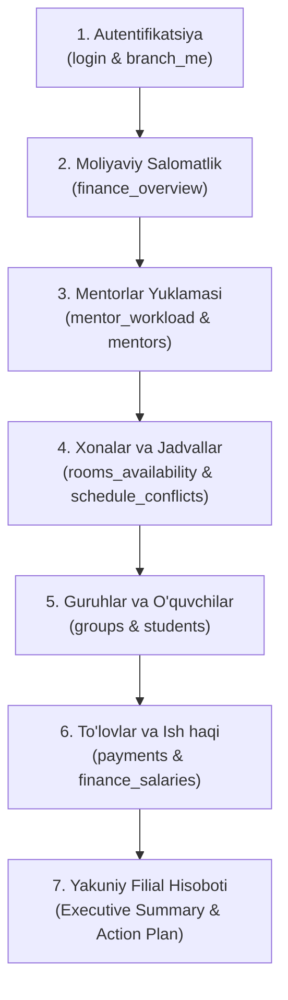

# MARS LMS Ish Zanjiri (Branch Operational & Financial Audit Workflow)

Ushbu skill `mars-lms` MCP serveri orqali `https://mars-backend-six.vercel.app` API laridan foydalanib, filialning barcha jarayonlarini to'liq va ketma-ketlikda (ish zanjiri) tahlil qilish imkonini beradi.

---

## 🔗 Ish Zanjiri Arxitekturasi (Workflow Overview)

Ish zanjiri 7 ta mantiqiy bosqichdan iborat:

---

## 🛠 Ish Zanjiri Bosqichlari va MCP Tool'lar

### 1-Bosqich: Autentifikatsiya va Identifikatsiya
Filial boshqaruviga kirish va sessiyani faollashtirish.
* **Tool:** `call_mcp_tool(ServerName="mars-lms", ToolName="login", Arguments={"phone": "998935344549", "password": "1234", "role": "admin"})`
* **Tool:** `call_mcp_tool(ServerName="mars-lms", ToolName="branch_me", Arguments={})`
* **Kutiladigan natija:** JWT token xotirada saqlanadi, filial ID (`branch._id`), nomi (`Test Branch`) va mas'ul shaxs tasdiqlanadi.

### 2-Bosqich: Moliyaviy Salomatlik Auditi
Filialning naqd, karta va bank tushumlari hamda xarajatlarini hisoblash.
* **Tool:** `call_mcp_tool(ServerName="mars-lms", ToolName="finance_overview", Arguments={})`
* **Tahlil qilinadigan ko'rsatkichlar:**
  * Jami daromad (`totalIncome`) va Jami xarajat (`totalExpense`)
  * Sof operatsion foyda/zarar (`netProfit`)
  * To'lov kanallari (`card`, `cash`, `transfer`)
  * Oylik dinamika trendi (`monthlyTrend`)

### 3-Bosqich: Mentorlar Yuklamasi Balansi
Mentorlar bo'yicha guruhlar va o'quvchilar taqsimoti, bo'sh o'rinlar.
* **Tool:** `call_mcp_tool(ServerName="mars-lms", ToolName="mentor_workload", Arguments={"max_groups": 3})`
* **Tool:** `call_mcp_tool(ServerName="mars-lms", ToolName="mentors", Arguments={})`
* **Tahlil qilinadigan ko'rsatkichlar:**
  * Kimda ortiqcha yuklama (`overloadedMentorsCount`)
  * Kim yangi guruh qabul qila oladi (`canTakeNewGroup`)
  * Yangi guruh ochish uchun tavsiya etilgan murabbiy (`recommendations`)

### 4-Bosqich: Xonalar Bandligi va Jadval To'qnashuvlari
Dars xonalarining yetishmasligi va vaqt slotlaridagi konfliktlar.
* **Tool:** `call_mcp_tool(ServerName="mars-lms", ToolName="rooms_availability", Arguments={})`
* **Tool:** `call_mcp_tool(ServerName="mars-lms", ToolName="schedule_conflicts", Arguments={})`
* **Tahlil qilinadigan ko'rsatkichlar:**
  * Bo'sh xonalar soni va yuklama foizi (`utilizationPercent`)
  * Jadvali belgilanmagan guruhlar (`unscheduled_group`)
  * Vaqt slotlari bo'yicha to'qnashuv xavfi (`room_shortage`)

### 5-Bosqich: Guruhlar va O'quvchilar Sig'imi
Filial guruhlari, bo'sh joylar va o'quvchilar davomati/qarzdorligi.
* **Tool:** `call_mcp_tool(ServerName="mars-lms", ToolName="groups", Arguments={})`
* **Tool:** `call_mcp_tool(ServerName="mars-lms", ToolName="students", Arguments={"page": 1, "limit": 20})`
* **Tahlil qilinadigan ko'rsatkichlar:**
  * Guruhlar to'lganlik darajasi (`availableSeats`, `isFull`)
  * O'quvchilar balansi, qarzdorlik (`due`, `paid`, `remaining`, `isOverdue`)

### 6-Bosqich: To'lovlar va Ish Haqi Monitoringi
Oxirgi kassa tushumlari va o'qituvchilar/xodimlar maoshlari nazorati.
* **Tool:** `call_mcp_tool(ServerName="mars-lms", ToolName="payments", Arguments={"limit": 10})`
* **Tool:** `call_mcp_tool(ServerName="mars-lms", ToolName="finance_salaries", Arguments={})`
* **Tahlil qilinadigan ko'rsatkichlar:**
  * Kutilayotgan (`pending`) va to'langan (`paid`) to'lovlar
  * Xodimlar oylik maoshlari to'lanish statusi

### 7-Bosqich: Yig'ma Xulosa va Qadam-baqadam Harakatlar Rejasi
Agent zanjir yakunida quyidagi shablon asosida hisobot shakllantiradi:
1. **Filial Umumiy Holati (KPI Scorecard)**
2. **Aniqlangan Muammo va Xavflar (Critical Findings)**
3. **Zudlik bilan Ko'rilishi Kerak Bo'lgan 3 Ta Amaliy Harakat (Action Plan)**

---

## ⚡ Avtomatlashtirilgan Ish Zanjiri Skripti

Ish zanjirini mustaqil ravishda Python orqali ishga tushirish uchun quyidagi yordamchi skriptdan foydalaniladi:
- [run_audit_chain.py](./scripts/run_audit_chain.py)
